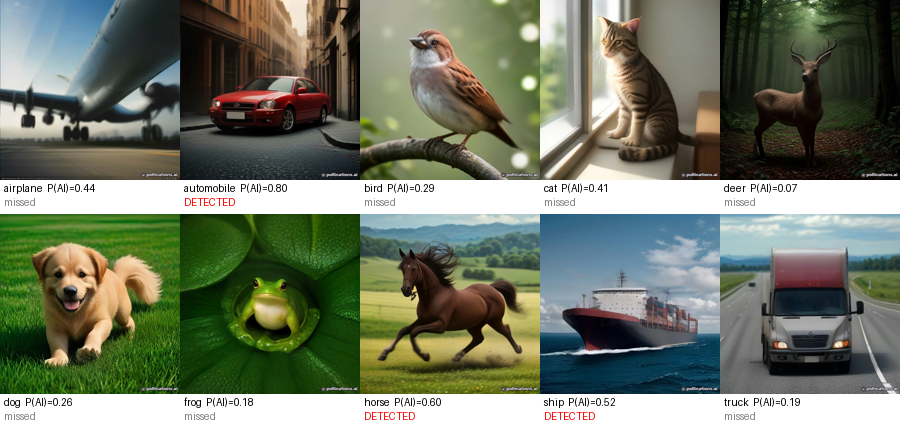

# Detector evaluation on generated images

* Source of AI images: **pollinations**, 10 images, one per CIFAR-10 class
* Models: CNN (raw pixels), Random Forest (handcrafted), XGBoost (handcrafted) (all trained on CIFAKE 32x32)
* Every image is AI-generated, so the ideal output is P(AI) = 1 and **detection rate = recall on fakes**.
* Threshold 0.5. Images are centre-cropped to a square and resized to 32x32 (bilinear), like in training.

## 1. Detection rate on generated images (original, no perturbation)

| Model | Detected | Detection rate | Mean P(AI) | Median P(AI) |
|---|---|---|---|---|
| CNN (raw pixels) | 1/10 | 10% | 0.176 | 0.051 |
| Random Forest (handcrafted) | 5/10 | 50% | 0.482 | 0.473 |
| XGBoost (handcrafted) | 5/10 | 50% | 0.465 | 0.491 |
| Ensemble | 3/10 | 30% | 0.375 | 0.349 |

## 2. Robustness: detection rate under perturbations

| Condition | CNN (raw pixels) | Random Forest (handcrafted) | XGBoost (handcrafted) | Ensemble |
|---|---|---|---|---|
| original | 10% (0.18) | 50% (0.48) | 50% (0.47) | 30% (0.37) |
| original + TTA(4 crops) | 10% (0.24) | 40% (0.50) | 40% (0.46) | 30% (0.40) |
| JPEG q=75 | 10% (0.18) | 50% (0.48) | 50% (0.47) | 30% (0.37) |
| downscale 50% | 10% (0.17) | 50% (0.48) | 50% (0.44) | 30% (0.36) |
| noise sigma=8 | 10% (0.17) | 50% (0.48) | 50% (0.42) | 20% (0.36) |
| centre crop 70% | 20% (0.20) | 40% (0.44) | 20% (0.35) | 30% (0.33) |

_Cell = detection rate (mean P(AI))._

## 3. In-domain reference (CIFAKE test set)

In-domain CIFAKE test sample: 300 real + 300 fake (32x32).

| Model | CIFAKE accuracy | CIFAKE AUC | AUC: generated fakes vs CIFAKE reals |
|---|---|---|---|
| CNN (raw pixels) | 93.7% | 0.994 | 0.855 |
| Random Forest (handcrafted) | 91.8% | 0.975 | 0.855 |
| XGBoost (handcrafted) | 94.5% | 0.989 | 0.871 |
| Ensemble | 96.2% | 0.993 | 0.875 |

## Per-image P(AI) (original)

| Image | Size | CNN (raw pixels) | Random Forest (handcrafted) | XGBoost (handcrafted) | Ensemble |
|---|---|---|---|---|---|
| 00_airplane.png | 768x768 | 0.002 | 0.640 | 0.680 | 0.441 |
| 01_automobile.png | 768x768 | 0.947 | 0.653 | 0.790 | 0.797 |
| 02_bird.png | 768x768 | 0.187 | 0.417 | 0.274 | 0.293 |
| 03_cat.png | 768x768 | 0.015 | 0.530 | 0.671 | 0.405 |
| 04_deer.png | 768x768 | 0.001 | 0.197 | 0.001 | 0.066 |
| 05_dog.png | 768x768 | 0.088 | 0.380 | 0.312 | 0.260 |
| 06_frog.png | 768x768 | 0.001 | 0.403 | 0.137 | 0.181 |
| 07_horse.png | 768x768 | 0.203 | 0.653 | 0.932 | 0.596 |
| 08_ship.png | 768x768 | 0.316 | 0.570 | 0.678 | 0.521 |
| 09_truck.png | 768x768 | 0.002 | 0.380 | 0.179 | 0.187 |

